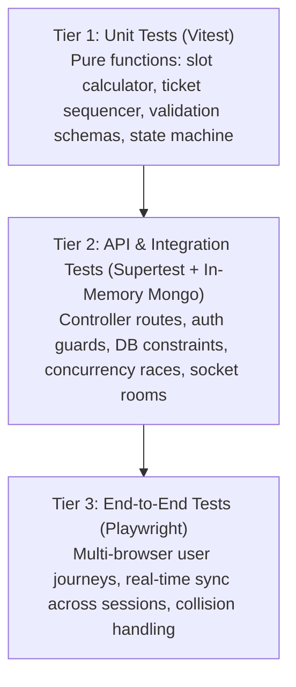

# Acceptance Criteria & Verification Matrix
## QueueFlow — Intelligent Appointment & Real-Time Queue Management System

**Document Version:** 1.1.0
**Status:** Approved for Planning (Consistency & Correctness Revision)
**Standard:** Gherkin (Given-When-Then), Automated Quality Gates & Manual QA

---

## 1. Testing Strategy & Quality Gates

To guarantee portfolio quality, maintainability, and regression resistance, QueueFlow enforces a three-tiered testing pyramid:

### Quality Gate Requirements
- **Type Safety:** 100% strict TypeScript mode enabled with 0 compilation errors (`tsc --noEmit`) across `shared`, `server`, and `client`.
- **Domain Coverage Target:** $\ge 80\%$ statement coverage on `/server/src/services`, `/server/src/controllers`, and `/server/src/utils`. *Note: Test coverage indicates thorough exercise of planned paths, but is not treated as an absolute proof of bug-free code.*
- **Concurrency Guard:** 100% pass rate on concurrent slot reservation tests (0 double-bookings allowed under parallel requests).
- **Security Scans:** Automated checks verify that client registration cannot inject privileged roles, unauthenticated requests receive 401, unauthorized cross-user modifications receive 403, and public display endpoints expose zero PII.
- **WebSocket Latency Target:** Under local/staging test harness conditions, 99% of queue events are received by subscribed clients within 200ms of database commit.

---

## 2. User Stories & Acceptance Criteria (Gherkin)

### US-1: Customer Registration & Privilege Escalation Prevention
**As a** new customer
**I want to** register for an account using my email and password
**So that** I can book appointments and track queue tickets without the system allowing unauthorized role manipulation.

#### Scenario 1.1: Successful customer registration
- **Given** I am an unauthenticated user on the registration page
- **When** I submit `name: "Elena Rostova"`, `email: "elena@example.com"`, `phone: "555-0199"`, and `password: "SecurePass123!"`
- **Then** the server creates a new user in MongoDB with `role: "CUSTOMER"`
- **And** the password in the database is hashed with `bcrypt` (never plaintext)
- **And** an `HttpOnly`, `SameSite=Lax` cookie is set
- **And** the response returns HTTP `201 Created` with standard envelope `{"success": true, "data": { "user": { "id": "...", "email": "elena@example.com", "role": "CUSTOMER" } }}`.

#### Scenario 1.2: Client attempts role escalation during registration
- **Given** a malicious registration payload containing `"role": "ADMIN"` or `"role": "STAFF"`
- **When** submitted to `POST /api/v1/auth/register`
- **Then** the server validation schema strips or rejects the `role` field
- **And** the user created in the database is strictly assigned `role: "CUSTOMER"`
- **And** administrative privileges are never granted via the public registration endpoint.

#### Scenario 1.3: Duplicate email registration rejected
- **Given** an existing user with email `"elena@example.com"`
- **When** a registration request is submitted with `"elena@example.com"`
- **Then** the server responds with HTTP `409 Conflict`
- **And** the response body contains `{"success": false, "error": {"code": "EMAIL_ALREADY_EXISTS"}}`.

#### Scenario 1.4: Server-side session invalidation on logout
- **Given** an authenticated user with an active session in MongoDB
- **When** the user submits `POST /api/v1/auth/logout`
- **Then** the server marks the user's session record in MongoDB as `isValid: false`
- **And** clears the `token` cookie with matching security flags
- **And** responds with HTTP `200 OK` (`{"success": true, "data": null, "message": "Logged out successfully"}`).

#### Scenario 1.5: Attempted reuse of copied JWT after logout rejected
- **Given** a user has logged out and their session was marked `isValid: false`
- **When** an attacker or client presents the previously valid copied JWT (via cookie or `Authorization` header) to a protected endpoint (e.g., `GET /api/v1/auth/me` or `GET /api/v1/appointments/my`)
- **Then** `authGuard` verifies the JWT signature and queries MongoDB for the referenced `sessionId`
- **And** finds `isValid === false`
- **And** immediately rejects the request with HTTP `401 Unauthorized`
- **And** the response body contains `{"success": false, "error": {"code": "SESSION_REVOKED"}}`
- **And** no protected data or operation is permitted.

#### Scenario 1.6: Expired JWT rejected on server
- **Given** a JWT whose 24-hour expiration timestamp has elapsed
- **When** submitted to any protected endpoint
- **Then** `authGuard` verification fails
- **And** the server responds with HTTP `401 Unauthorized` (`{"success": false, "error": {"code": "TOKEN_EXPIRED"}}`).

---

### US-2: Role-Based Route Protection & Server-Side Resource Ownership
**As an** authenticated user
**I want** the system to enforce strict role checks and resource ownership
**So that** customers cannot view or cancel other customers' bookings, and non-staff users cannot access queue counter controls.

#### Scenario 2.1: Customer denied access to staff queue endpoints
- **Given** an authenticated user with `role: "CUSTOMER"`
- **When** they make a request to `GET /api/v1/queue/today` or `POST /api/v1/services`
- **Then** the server responds with HTTP `403 Forbidden`
- **And** the response body contains `{"success": false, "error": {"code": "FORBIDDEN_INSUFFICIENT_PERMISSIONS"}}`.

#### Scenario 2.2: Customer attempts to cancel another customer's appointment
- **Given** an appointment belonging to Customer A (`customerId: "A-123"`)
- **When** Customer B (`customerId: "B-456"`) calls `PATCH /api/v1/appointments/A-123/cancel`
- **Then** the server verifies resource ownership (`appointment.customerId !== req.user.id`)
- **And** responds with HTTP `403 Forbidden` (`{"success": false, "error": {"code": "FORBIDDEN_RESOURCE"}}`)
- **And** the appointment status remains unchanged.

---

### US-3: Discrete Slot Calculation & Calendar Boundaries
**As a** customer
**I want to** view available appointment time slots for a service and date
**So that** I only see valid open slots within business operating hours and business timezone.

#### Scenario 3.1: Slot calculation adheres to operating hours and discrete intervals
- **Given** a service with `durationMinutes: 30` and `bufferMinutes: 0`
- **And** business operating hours are `09:00` to `17:00` in `BUSINESS_TIMEZONE`
- **And** the requested date is a valid weekday with zero existing bookings
- **When** `GET /api/v1/appointments/available-slots?serviceId=...&date=YYYY-MM-DD` is queried
- **Then** the server returns 16 discrete slots starting at `09:00` and ending at `16:30`
- **And** every slot has a discrete 30-minute duration (`09:00 - 09:30`, `09:30 - 10:00`, etc.).

#### Scenario 3.2: Weekend dates return empty slots
- **Given** a requested date that falls on Saturday or Sunday in `BUSINESS_TIMEZONE`
- **When** available slots are queried
- **Then** the server returns HTTP `200 OK` with an empty data array `[]`
- **And** the message indicates the business is closed on the selected date.

#### Scenario 3.3: Existing active booking removes slot from availability
- **Given** an existing confirmed appointment (`status: "BOOKED"`) at `10:00 - 10:30`
- **When** available slots are queried for that date
- **Then** the slot `10:00 - 10:30` is excluded from the returned slots array
- **And** adjacent slots (`09:30 - 10:00` and `10:30 - 11:00`) remain available.

#### Scenario 3.4: Slot calculation enforces service buffer turnaround
- **Given** a service with `durationMinutes: 45` and `bufferMinutes: 15` ($\Delta t = 60\text{ min}$)
- **And** operating hours are `09:00` to `17:00` in `BUSINESS_TIMEZONE`
- **When** available slots are queried for a valid weekday with zero bookings
- **Then** the server returns 8 discrete slots starting at `09:00`, `10:00`, `11:00`, `12:00`, `13:00`, `14:00`, `15:00`, and `16:00`
- **And** each slot has `startTime` matching the grid, `endTime` equal to `startTime + 45 min`, with the 15-minute buffer reserved before the next slot
- **And** the last slot `16:00 - 16:45` finishes within operating hours including buffer ($16:45 + 15\text{ min} = 17:00$).

---

### US-4: Off-Grid Start Time Rejection & Concurrency Protection
**As a** system architect
**I want** the system to reject off-grid times and handle simultaneous booking requests
**So that** overlapping appointments cannot be created even under heavy concurrent load.

#### Scenario 4.1: Off-grid start time is rejected
- **Given** a booking request submitted with an off-grid time (e.g., `startTime: "09:17"`)
- **When** `POST /api/v1/appointments` is called
- **Then** the server validation layer rejects the request with HTTP `400 Bad Request`
- **And** the error code is `VALIDATION_ERROR` with a descriptive message indicating that times must align with the service slot grid.

#### Scenario 4.2: Concurrent booking race condition on identical discrete slot
- **Given** an open slot `14:00 - 14:30` on a future date
- **When** Customer A and Customer B both submit booking requests for that exact slot at the exact same millisecond
- **Then** exactly ONE request succeeds with HTTP `201 Created`
- **And** the second request triggers MongoDB's compound partial unique index on `{ serviceId, scheduledDate, startTime }`
- **And** the server translates the duplicate key error into HTTP `409 Conflict` (`SLOT_ALREADY_BOOKED`)
- **And** the database contains exactly ONE appointment record for that slot.

---

### US-5: Customer Appointment Cancellation & Slot Recovery
**As a** customer
**I want to** cancel an upcoming appointment
**So that** the time slot is immediately freed for another customer to book.

#### Scenario 5.1: Valid appointment cancellation frees slot
- **Given** I have a booked appointment scheduled 24 hours in the future
- **When** I call `PATCH /api/v1/appointments/:id/cancel`
- **Then** the appointment status updates to `CANCELLED`
- **And** the record is excluded from the partial unique index
- **And** when available slots are queried for that date and service, the slot immediately reappears as open.

---

### US-6: Idempotent Day-of-Appointment Check-In
**As a** customer with a booked appointment
**I want to** check in on the day of my appointment
**So that** I receive a queue ticket without duplicate submissions creating multiple tickets.

#### Scenario 6.1: Successful check-in generates sequential ticket
- **Given** I have a confirmed appointment for today in `BUSINESS_TIMEZONE`
- **And** current time is within the check-in window (-30 min to +15 min of start time)
- **When** I submit `POST /api/v1/queue/check-in` with my `appointmentId`
- **Then** a `QueueTicket` is created with monotonic `sequenceNumber` and formatted `ticketNumber: "A-001"`
- **And** the appointment status updates to `CHECKED_IN`
- **And** the server emits `queue:ticket-created` to the staff dashboard.

#### Scenario 6.2: Concurrent duplicate check-in attempts on same appointment
- **Given** an appointment ready for check-in
- **When** two parallel check-in requests are submitted simultaneously for the same `appointmentId`
- **Then** MongoDB's sparse unique index on `{ appointmentId: 1 }` prevents a second ticket
- **And** exactly one new ticket is created
- **And** the concurrent/subsequent request idempotently returns the existing ticket with HTTP `200 OK` (or HTTP `400 APPOINTMENT_ALREADY_CHECKED_IN` if the appointment is already completed/terminal).

---

### US-7: Staff Counter Management & State Machine Enforcement
**As a** staff member at Counter 1
**I want to** call the next waiting ticket and transition it through the service lifecycle
**So that** invalid state transitions are rejected and the queue progresses accurately.

#### Scenario 7.1: Valid sequential progression
- **Given** ticket `A-001` is in `WAITING` status
- **When** staff at Counter 1 calls the ticket (`status: "CALLED"`)
- **Then** the status updates to `CALLED`, `counterName: "Counter 1"`, and `calledAt` is set
- **When** the customer arrives and staff begins service (`status: "SERVING"`)
- **Then** status updates to `SERVING` and `servingStartedAt` is set
- **When** service finishes and staff completes it (`status: "COMPLETED"`)
- **Then** status updates to `COMPLETED` and `completedAt` is set.

#### Scenario 7.2: Invalid state transition rejected
- **Given** ticket `A-001` is in `WAITING` status
- **When** a request attempts to jump directly from `WAITING` to `COMPLETED`
- **Then** the server state machine rejects the request with HTTP `400 Bad Request`
- **And** the error code is `INVALID_STATE_TRANSITION`
- **And** the ticket remains in `WAITING` status.

---

### US-8: Multi-Operator Collision Handling (Staff Concurrency)
**As a** staff operator
**I want** the system to prevent two counters from calling the same ticket
**So that** multiple operators do not accidentally service the same customer.

#### Scenario 8.1: Conflicting ticket call by two operators
- **Given** ticket `A-001` is in `WAITING` status
- **When** Operator at Counter 1 and Operator at Counter 2 both click "Call Next" on ticket `A-001` simultaneously
- **Then** Counter 1's atomic update matches `status: "WAITING"` and succeeds with HTTP `200 OK`
- **And** Counter 2's atomic update finds 0 matching documents (status is now `CALLED`)
- **And** the server returns HTTP `409 Conflict` with error code `TICKET_ALREADY_CLAIMED`
- **And** Counter 2's dashboard displays an alert prompting them to refresh and select the next ticket.

---

### US-9: Socket.IO Handshake Security & Room Authorization
**As a** security reviewer
**I want** WebSocket connections to enforce authentication and room authorization
**So that** guests cannot eavesdrop on private user notifications or staff operational feeds.

#### Scenario 9.1: Unauthorized user attempts to join staff room
- **Given** a socket client authenticated as `role: "CUSTOMER"`
- **When** the client emits `room:join` with `{ room: "queue:staff" }`
- **Then** the Socket.IO server checks `socket.data.user.role`
- **And** denies room entry, returning an error acknowledgement `{ success: false, error: "UNAUTHORIZED_ROOM" }`.

#### Scenario 9.2: Customer attempts to join another customer's personal room
- **Given** a socket client authenticated as Customer A (`userId: "User-A"`)
- **When** the client attempts to join room `"ticket:user:User-B"`
- **Then** the server verifies `socket.data.user.id !== "User-B"` and denies entry.

---

### US-10: Client Disconnection & Authoritative Snapshot Recovery
**As a** customer or staff operator
**I want** my display to synchronize after a temporary network drop
**So that** I never view stale queue state after reconnecting.

#### Scenario 10.1: Reconnection snapshot recovery
- **Given** a client is connected to the queue room
- **When** network drops and reconnects after 10 seconds
- **And** during the drop, ticket `A-001` was completed and `A-002` was called
- **Then** upon the `reconnect` event, the client triggers a REST query to `/api/v1/queue/today` (or `/public-status`)
- **And** the UI state seamlessly updates to reflect the current authoritative database state.

---

### US-11: Public Display Privacy Guard (Zero PII)
**As a** compliance reviewer
**I want** the public display screen and feeds to contain zero personal information
**So that** customer privacy is maintained in public waiting areas.

#### Scenario 11.1: Verification of public queue payload
- **Given** the public display endpoint `GET /api/v1/queue/public-status` or WebSocket event `queue:public-summary`
- **When** inspected for customer data
- **Then** payload contains strictly: `ticketNumber`, `counterName`, `serviceName`, `status`, and queue counts
- **And** contains **zero** customer names, phone numbers, email addresses, or internal database user IDs.

---

## 3. Automated Verification Matrix

| Test Level | Scope | Test Tool & Command | Target Invariant Verified |
| :--- | :--- | :--- | :--- |
| **Unit** | Slot Availability Math | `npm run test:server -- tests/unit/slotCalculator.test.ts` | Operating hours boundaries, weekend exclusion, past time exclusion, discrete grid math, buffer turnaround ($\Delta t = \text{duration} + \text{buffer}$). |
| **Unit** | Atomic Ticket Sequencer | `npm run test:server -- tests/unit/ticketSequencer.test.ts` | Daily sequence reset in `BUSINESS_TIMEZONE`, monotonic increments, string padding (`A-001`). |
| **Unit** | State Machine Guard | `npm run test:server -- tests/unit/stateMachine.test.ts` | Allows valid status transitions; rejects invalid transitions (e.g. `WAITING` $\rightarrow$ `COMPLETED`). |
| **Integration** | Auth, RBAC & Session Revocation | `npm run test:server -- tests/integration/auth.test.ts` | Bcrypt hashing, HTTP-only cookie, stripping injected `role: "ADMIN"`, session creation, atomic logout revocation, copied JWT rejection (`SESSION_REVOKED`), and token expiry (`TOKEN_EXPIRED`). |
| **Integration** | Resource Ownership | `npm run test:server -- tests/integration/ownership.test.ts` | Customer cannot view or cancel another customer's appointment (403). |
| **Integration** | Off-Grid Slot Validation | `npm run test:server -- tests/integration/slotValidation.test.ts` | Off-grid `startTime` (`09:17`) returns 400 `VALIDATION_ERROR`. |
| **Integration** | Concurrent Booking Race | `npm run test:server -- tests/integration/concurrency.test.ts` | 5 parallel requests to same slot $\rightarrow$ exactly 1 succeeds (201), 4 receive 409 `SLOT_ALREADY_BOOKED`. |
| **Integration** | Concurrent Check-In Race | `npm run test:server -- tests/integration/checkInConcurrency.test.ts` | Parallel check-ins on same appointment create exactly 1 ticket. |
| **Integration** | Multi-Operator Collision | `npm run test:server -- tests/integration/staffConflict.test.ts` | Two operators calling same ticket $\rightarrow$ 1 succeeds (200), 1 gets 409 `TICKET_ALREADY_CLAIMED`. |
| **Integration** | Socket Room Security | `npm run test:server -- tests/integration/socketSecurity.test.ts` | Unauthorized room join rejected; events emitted only after DB write commits. |
| **E2E** | Customer Booking Journey | `npm run test:e2e -- e2e/customerBooking.spec.ts` | Register $\rightarrow$ select service $\rightarrow$ book slot $\rightarrow$ view in dashboard $\rightarrow$ cancel. |
| **E2E** | Multi-Session Live Queue | `npm run test:e2e -- e2e/realTimeSync.spec.ts` | Staff calls ticket $\rightarrow$ Customer tracker and Public Display update live without refresh. |

---

## 4. Manual QA Smoke Test Procedure

When verifying a deployment before sign-off:

1. **Environment & Seed Setup:**
   - Run `npm run seed:admin` to initialize test admin (`admin@queueflow.com`).
   - Run `npm run seed:services` to seed sample services (`Consultation` 30m, `Express Check` 15m).
2. **Customer Registration & Booking:**
   - Open incognito window at `http://localhost:5173/register`.
   - Register customer `elena@test.com`. Verify redirected to `/services`.
   - Select "Consultation", pick a future weekday date. Verify slots are on discrete 30-min increments.
   - Click slot `10:00 - 10:30`. Confirm booking. Verify booking appears in "My Appointments".
3. **Cancellation & Slot Recovery:**
   - Cancel the booking.
   - Immediately return to the booking page for the same service and date.
   - Verify slot `10:00 - 10:30` is selectable again.
4. **Day-of Check-In & Multi-Counter Smoke Test:**
   - Book a test appointment set for today. Click "Check In Now".
   - Verify Ticket `A-001` is generated and Customer Tracker opens.
   - In a second browser window, log in as staff (`staff@queueflow.com`).
   - Open Counter Dashboard, set counter to "Counter 1".
   - In a third window, open `/queue/display`. Verify ticket `A-001` appears in "Waiting" with no customer name.
   - In Staff Dashboard, click "Call Next".
   - **Verification:** Customer Tracker immediately updates to "CALLED - Proceed to Counter 1"; Public Display plays audio chime and flashes `NOW SERVING A-001 AT COUNTER 1`.
5. **Staff Collision Verification:**
   - In a fourth window, log in as a second staff operator at "Counter 2".
   - Attempt to call the same ticket simultaneously.
   - Verify Counter 2 receives a clear warning banner: "Ticket already claimed by another counter".
