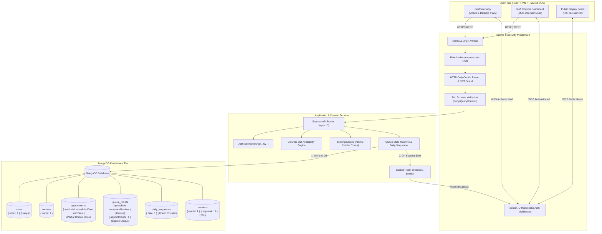
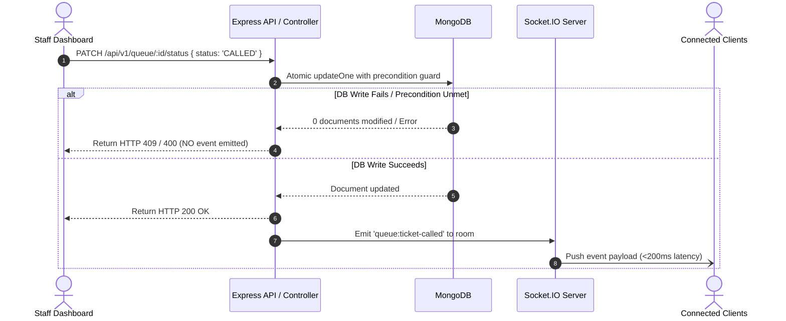

# System Architecture & Technical Design
## QueueFlow — Intelligent Appointment & Real-Time Queue Management System

**Document Version:** 1.1.0
**Status:** Approved for Planning (Consistency & Correctness Revision)
**Target Environment:** Node.js v22 LTS, React 18.3.x, Express 4.21.x, Mongoose 8.x, Socket.IO 4.8.x

---

## 1. System Overview & Context Diagram

QueueFlow combines a transactional RESTful API with bi-directional WebSocket channels (Socket.IO). The architecture cleanly decouples appointment scheduling from live queue execution while maintaining deterministic state synchronization across client displays.



---

## 2. Technology Stack & Tooling Baselines

The technology stack utilizes LTS and actively maintained releases. Concrete compatible versions will be locked in `package-lock.json` during Milestone 0:

| Layer | Technology | Compatible Baseline | Architectural Rationale |
| :--- | :--- | :--- | :--- |
| **Frontend Framework** | React + TypeScript | React `18.3.x`, TypeScript `5.x` | Industry-standard component model with maximum ecosystem compatibility and strict typing. |
| **Build Tool** | Vite | Vite `5.4.x` / `6.x` | Rapid HMR, optimized production rollup bundles, native ES modules. |
| **CSS / Styling** | Tailwind CSS | Tailwind CSS `3.4.x` | Standard utility-first CSS with deterministic design tokens, responsive breakpoints, and glassmorphic UI support. |
| **Icons & Audio** | Lucide React + Web Audio API | Latest | Consistent icon set and zero-dependency synthetic audio chimes for counter alerts. |
| **State & HTTP** | TanStack Query + Axios | Query `v5`, Axios `1.7.x` | Clean query caching, automatic re-fetching on window focus/reconnection, and cookie interceptors. |
| **Backend Runtime** | Node.js | `v22.x LTS` (Node 22.17.0) | High-performance asynchronous V8 runtime, native Fetch/Crypto APIs. |
| **Web Server** | Express | Express `4.21.x` | Battle-tested, lightweight HTTP middleware pipeline with predictable routing semantics. |
| **Data Validation** | Zod | Zod `3.23.x` | Strict runtime schema parsing, type inference, and input sanitization stripping unexpected properties. |
| **Database & ODM** | MongoDB + Mongoose | Mongoose `8.x` | Document model with atomic operations (`findOneAndUpdate`), partial indexes, and schema validation. |
| **Real-Time Engine** | Socket.IO | Socket.IO `4.8.x` | Bi-directional WebSocket transport with automatic reconnection, heartbeats, and room pub/sub isolation. |
| **Testing Suite** | Vitest, Supertest, Playwright | Latest | Vitest for unit tests; Supertest for API integration tests; Playwright for multi-browser E2E flows. |
| **Containerization** | Docker & Docker Compose | Compose v2 | Reproducible local and staging deployment with automated MongoDB volume initialization. |

---

## 3. Booking Correctness & Concurrency Architecture

### 3.1 Why a Naive Index Fails with Arbitrary Times
A common architectural flaw in booking systems is applying a unique index on `{ serviceId, scheduledDate, startTime }` and assuming it eliminates all overlaps.
- **Why this fails:** A unique index on `startTime` performs an exact string or timestamp equality comparison. If arbitrary start times are allowed (e.g., Client A requests `09:00 - 09:30` and Client B requests `09:15 - 09:45`), their `startTime` values (`"09:00"` vs `"09:15"`) do not collide in the index. Both records are written, resulting in a physical resource overlap $[09:15, 09:30)$ that violates operational capacity.
- **Why variable durations complicate continuous schedules:** If Service 1 requires 60 minutes and Service 2 requires 30 minutes on a shared resource, a booking at `09:00` occupies the resource until `10:00`. An appointment at `09:30` has a distinct start time but still collides.

### 3.2 The QueueFlow Discrete Slot Reservation Strategy
To eliminate interval race conditions in the MVP without requiring complex distributed interval-tree locks, QueueFlow enforces a **Discrete Uniform Slot Grid**:

1. **Discrete Grid Snapping & Interval Structure:**
   - Appointments can **only** be booked at discrete, predefined slot boundaries calculated by the server (e.g. `09:00`, `09:30`, `10:00`).
   - The cycle step interval is defined as $\Delta t = \text{durationMinutes} + \text{bufferMinutes}$. For example, a service with `durationMinutes: 30` and `bufferMinutes: 0` produces 30-minute intervals; with `durationMinutes: 45` and `bufferMinutes: 15`, $\Delta t = 60\text{ minutes}$.
   - All slot start times strictly snap to $t_{\text{start}} = \text{openingTime} + k \times \Delta t$ ($k \ge 0$) within business operating hours, where $t_{\text{start}} + \Delta t \le \text{closingTime}$ (09:00 to 17:00).
   - Each booking occupies two clearly defined temporal segments:
     - **Active Service Interval:** $[t_{\text{start}}, t_{\text{end}})$, where $t_{\text{end}} = t_{\text{start}} + \text{durationMinutes}$. Customer receives service during this window.
     - **Turnaround Buffer Interval:** $[t_{\text{end}}, t_{\text{start}} + \Delta t)$. Non-bookable operational buffer for sanitization, documentation, and desk turnover.
   - The next bookable discrete slot start time is strictly $t_{\text{next}} = t_{\text{start}} + \Delta t$.
   - The API validator strictly rejects off-grid start times (e.g., `09:17` returns `400 VALIDATION_ERROR`).
2. **Dedicated Service Station Concurrency Guarantee:**
   - In the MVP, each service corresponds to a dedicated service station/queue capacity of 1 client per discrete slot interval.
   - Because all appointments for a given service snap strictly to identical discrete start times ($09:00, 09:00 + \Delta t, \dots$), and the database enforces a compound partial unique index on `{ serviceId, scheduledDate, startTime }`, parallel booking attempts targeting conflicting availability are guaranteed to collide on the unique index constraint. Two concurrent requests can never successfully reserve conflicting availability.
3. **Database-Enforced Uniqueness Rule:**
   - The `appointments` collection enforces a compound partial unique index:
     ```javascript
     AppointmentSchema.index(
       { serviceId: 1, scheduledDate: 1, startTime: 1 },
       {
         unique: true,
         partialFilterExpression: {
           status: { $in: ['BOOKED', 'CHECKED_IN'] }
         }
       }
     );
     ```
4. **Handling Concurrency & Cancellation:**
   - **Concurrent Booking Race:** If two users simultaneously submit a reservation for slot `09:30`:
     - MongoDB's unique index atomically allows the first insert and rejects the second with error code `11000` (E11000 duplicate key error).
     - The Express error handler intercepts error `11000` and returns HTTP `409 Conflict` with error code `SLOT_ALREADY_BOOKED`.
   - **Cancellation & Slot Recovery:** When a user cancels an appointment, its status changes to `CANCELLED`.
     - Because the unique index has `partialFilterExpression: { status: { $in: ['BOOKED', 'CHECKED_IN'] } }`, the cancelled appointment falls out of the unique index constraint immediately.
     - The slot becomes instantly available in the next availability query and can be reserved by another customer without manual cleanup jobs.

---

## 4. Business Hours, Timezone & Calendar Boundaries

1. **Authoritative Timezone:**
   - All appointment schedules, slot computations, daily sequence resets, and check-in windows are evaluated relative to a single configurable business timezone: `BUSINESS_TIMEZONE` (e.g., `UTC` or `America/New_York`), managed via `date-fns-tz` or `luxon`.
   - Client local times are never used for database queries or business validation.
2. **Operating Hours:**
   - Standard operating hours: `09:00` to `17:00` Monday through Friday.
   - Closed Days: Saturday and Sunday. Queries for weekend dates return an empty slots array `[]`.
3. **Date Representation:**
   - Calendar dates are transmitted and stored in ISO 8601 calendar format: `YYYY-MM-DD`.
   - Times are transmitted and stored in 24-hour format: `HH:mm`.
4. **Daily Queue Reset Behavior:**
   - The queue operates on a daily scope. Each queue ticket is explicitly tagged with `queueDate: "YYYY-MM-DD"` evaluated in `BUSINESS_TIMEZONE`.
   - Daily sequence counters reset cleanly every midnight in the business timezone via the `DailySequence` model.
   - Old tickets remain in the database for analytics and audit trails, but are excluded from `/api/v1/queue/today`.

---

## 5. Data Models & Schema Design

### 5.1 `User` Model
```typescript
export enum UserRole {
  CUSTOMER = 'CUSTOMER',
  STAFF = 'STAFF',
  ADMIN = 'ADMIN'
}

export interface IUser {
  _id: string;
  name: string;
  email: string;
  passwordHash: string;
  phone: string;
  role: UserRole;
  isActive: boolean;
  createdAt: Date;
  updatedAt: Date;
}
```
**Security Constraints & Indexes:**
- `{ email: 1 }` (Unique).
- `UserSchema.pre('save')` strips any attempted modification of `role` unless performed via an administrative context.

---

### 5.2 `Service` Model
```typescript
export interface IService {
  _id: string;
  name: string;
  description: string;
  durationMinutes: number; // e.g. 15, 30 (must align with slot grid)
  bufferMinutes: number;   // Turnaround interval
  isActive: boolean;
  colorCode?: string;
  createdAt: Date;
  updatedAt: Date;
}
```
**Indexes:**
- `{ name: 1 }` (Unique)
- `{ isActive: 1 }`

---

### 5.3 `Appointment` Model
```typescript
export enum AppointmentStatus {
  BOOKED = 'BOOKED',
  CHECKED_IN = 'CHECKED_IN',
  COMPLETED = 'COMPLETED',
  CANCELLED = 'CANCELLED',
  NO_SHOW = 'NO_SHOW'
}

export interface IAppointment {
  _id: string;
  customerId: string;      // Ref: User
  serviceId: string;       // Ref: Service
  scheduledDate: string;   // 'YYYY-MM-DD' in BUSINESS_TIMEZONE
  startTime: string;       // '09:30' (strictly snaps to discrete grid)
  endTime: string;         // '10:00' (strictly startTime + durationMinutes; buffer turnaround follows)
  status: AppointmentStatus;
  notes?: string;
  createdAt: Date;
  updatedAt: Date;
}
```
**Indexes:**
- `{ serviceId: 1, scheduledDate: 1, startTime: 1 }` (Unique with partial filter `status: { $in: ['BOOKED', 'CHECKED_IN'] }`).
- `{ customerId: 1, scheduledDate: -1 }` (Customer history query index).
- `{ scheduledDate: 1, status: 1 }` (Daily staff lookup index).

---

### 5.4 `QueueTicket` Model
```typescript
export enum TicketStatus {
  WAITING = 'WAITING',
  CALLED = 'CALLED',
  SERVING = 'SERVING',
  COMPLETED = 'COMPLETED',
  CANCELLED = 'CANCELLED',
  NO_SHOW = 'NO_SHOW'
}

export interface IQueueTicket {
  _id: string;
  ticketNumber: string;    // e.g., 'A-001'
  sequenceNumber: number;  // Monotonic integer per day (1, 2, 3...)
  queueDate: string;       // 'YYYY-MM-DD' in BUSINESS_TIMEZONE
  serviceId: string;       // Ref: Service
  customerId?: string;     // Ref: User (optional for walk-in guests)
  customerName: string;    // Display name (redacted from public payloads)
  customerPhone?: string;  // Contact info (redacted from public payloads)
  appointmentId?: string;  // Ref: Appointment (optional)
  status: TicketStatus;
  counterName?: string;    // e.g., "Counter 1"
  servedBy?: string;       // Ref: User (Staff ID)
  checkInTime: Date;
  calledAt?: Date;
  servingStartedAt?: Date;
  completedAt?: Date;
  createdAt: Date;
  updatedAt: Date;
}
```
**Indexes:**
- `{ queueDate: 1, sequenceNumber: 1 }` (Unique constraint per business day).
- `{ appointmentId: 1 }` (Sparse Unique index to prevent duplicate check-ins).
- `{ queueDate: 1, serviceId: 1, status: 1 }` (Live queue board ordering).

---

### 5.5 `DailySequence` Model (Atomic Ticket Number Sequencer)
To prevent race conditions where two concurrent check-ins obtain the same ticket sequence number:
```typescript
export interface IDailySequence {
  _id: string;
  date: string;            // 'YYYY-MM-DD'
  lastSequence: number;    // Monotonically increasing counter
  updatedAt: Date;
}
```
**Atomic Increment Operation:**
```typescript
const sequenceDoc = await DailySequence.findOneAndUpdate(
  { date: todayDateString },
  { $inc: { lastSequence: 1 } },
  { upsert: true, new: true, setDefaultsOnInsert: true }
);
const ticketNumber = `A-${String(sequenceDoc.lastSequence).padStart(3, '0')}`;
```
**Indexes:**
- `{ date: 1 }` (Unique constraint to ensure race-free upsert).

---

### 5.6 `Session` Model (Server-Verifiable Session Revocation)
To prevent reuse of copied or intercepted JWTs after logout and provide deterministic session termination:
```typescript
export interface ISession {
  _id: string;             // Unique Session ID referenced in JWT
  userId: string;          // Ref: User
  isValid: boolean;        // Revoked to false on logout
  userAgent?: string;      // Audit telemetry
  ipAddress?: string;      // Audit telemetry
  expiresAt: Date;         // 24 hours from issuance (synchronized with JWT exp)
  createdAt: Date;
  updatedAt: Date;
}
```
**Indexes & Constraints:**
- `{ expiresAt: 1 }` (TTL index with `expireAfterSeconds: 0`: MongoDB automatically purges expired sessions).
- `{ userId: 1 }` (User session audit queries).
- `{ _id: 1, isValid: 1 }` (Low-latency lookup in authGuard).

---

## 6. Queue State Machine & Staff Concurrency Control

### 6.1 State Transition Matrix
The queue ticket lifecycle is strictly governed by the following valid transitions:

| Current Status | Allowed Next Statuses | Triggered By | Validation Precondition |
| :--- | :--- | :--- | :--- |
| **`WAITING`** | `CALLED`, `CANCELLED` | Staff ("Call Next") / Customer ("Leave") | Ticket must be unassigned to any counter. |
| **`CALLED`** | `SERVING`, `NO_SHOW`, `WAITING` | Staff ("Begin Serving", "No Show", or "Recall") | Must be assigned to acting staff member's counter. |
| **`SERVING`** | `COMPLETED`, `CANCELLED` | Staff ("Finish Service" or "Abort") | Must be currently in-service at counter. |
| **`COMPLETED`** | *None (Terminal)* | — | Read-only record. |
| **`NO_SHOW`** | *None (Terminal)* | — | Read-only record. |
| **`CANCELLED`** | *None (Terminal)* | — | Read-only record. |

Any state transition not explicitly allowed in this matrix is rejected by the server with HTTP `400 Bad Request` (`INVALID_STATE_TRANSITION`).

### 6.2 Multi-Operator Conflict Resolution (Atomic Claiming)
In an environment with multiple counters (e.g., Counter 1 and Counter 2), two staff members might simultaneously click "Call Next" on the same waiting customer.
- **QueueFlow Solution:** State updates use atomic matching conditions in MongoDB:
  ```typescript
  const updatedTicket = await QueueTicket.findOneAndUpdate(
    {
      _id: ticketId,
      status: TicketStatus.WAITING // Precondition guard
    },
    {
      $set: {
        status: TicketStatus.CALLED,
        counterName: operatorCounter,
        servedBy: req.user.id,
        calledAt: new Date()
      }
    },
    { new: true }
  );

  if (!updatedTicket) {
    throw new AppError(409, 'TICKET_ALREADY_CLAIMED', 'This ticket has already been called or modified by another counter.');
  }
  ```
- If Counter 1 commits first, Counter 2's query matches 0 records, receives `409 TICKET_ALREADY_CLAIMED`, and the staff UI automatically prompts to refresh the queue board.

### 6.3 Appointment Check-In, Idempotency & Failure Recovery
When a customer checks in via `POST /api/v1/queue/check-in`:
1. **Window Validation:** Evaluated strictly in `BUSINESS_TIMEZONE`, check-in is permitted exclusively on the appointment date within the window $[-30\text{ min}, +15\text{ min}]$ relative to `startTime`.
2. **Idempotent Duplicate Handling:**
   - If an active `QueueTicket` already exists for `appointmentId` (`status IN ['WAITING', 'CALLED', 'SERVING']`), the server idempotently returns HTTP `200 OK` with the existing ticket details, preventing redundant counter assignments or client crashes on network retries.
   - If the appointment is already completed, cancelled, or marked no-show, or if check-in is attempted for a non-booked appointment, the server rejects the request with HTTP `400 Bad Request` (`APPOINTMENT_ALREADY_CHECKED_IN` or `INVALID_STATE_TRANSITION`).
3. **Atomic Concurrency Protection:**
   - In a concurrent race condition, MongoDB's sparse unique index `{ appointmentId: 1 }` guarantees only one `QueueTicket` record can be created. The concurrent call catches duplicate key error `11000` and recovers by querying and returning the active ticket (HTTP 200).

---

## 7. Authentication, Session Security & Privacy

### 7.1 Role Privilege Escalation Prevention
- The customer registration endpoint (`POST /api/v1/auth/register`) enforces a strict Zod schema that omits `role`.
- Even if a malicious request injects `role: "ADMIN"`, the backend unconditionally overrides it:
  ```typescript
  const user = await User.create({
    name: body.name,
    email: body.email,
    passwordHash: hashed,
    phone: body.phone,
    role: UserRole.CUSTOMER // Hardcoded server assignment
  });
  ```
- **Staff and Admin Provisioning:**
  - Local Dev: Managed via a secure CLI command: `npm run seed:admin` using environment variables `ADMIN_EMAIL` and `ADMIN_INITIAL_PASSWORD`.
  - Production: Provisioned during deployment migrations or created by an authenticated `ADMIN` via `POST /api/v1/admin/users`.

### 7.2 Cookie Configuration, Server-Verifiable Sessions & Revocation
To eliminate the vulnerability where a copied or intercepted JWT remains valid after client-side cookie deletion, QueueFlow enforces **Server-Verifiable Session Revocation**:

1. **Session Issuance:**
   - Upon successful login or registration, the server creates a `Session` record in MongoDB:
     ```typescript
     const session = await Session.create({
       userId: user._id,
       isValid: true,
       expiresAt: new Date(Date.now() + 24 * 60 * 60 * 1000) // 24 hours
     });
     ```
   - A signed JWT is issued containing `{ userId: user._id, email: user.email, role: user.role, sessionId: session._id }`.
   - Transmitted exclusively via an `HttpOnly`, `SameSite=Lax` cookie:
     ```typescript
     res.cookie('token', token, {
       httpOnly: true,
       secure: process.env.NODE_ENV === 'production', // False on local HTTP, True on HTTPS
       sameSite: 'lax',
       path: '/',
       maxAge: 24 * 60 * 60 * 1000 // 24 hours
     });
     ```

2. **Server-Side Verification Pipeline (`authGuard`):**
   - Step 1: Extracts token from cookie (or `Authorization: Bearer <token>` for programmatic API requests).
   - Step 2: Validates cryptographic signature and temporal expiry via `jwt.verify(token, JWT_SECRET)`. If expired, returns HTTP `401 Unauthorized` (`TOKEN_EXPIRED`).
   - Step 3: Queries MongoDB:
     ```typescript
     const activeSession = await Session.findOne({ _id: decoded.sessionId, isValid: true });
     if (!activeSession) {
       throw new AppError(401, 'SESSION_REVOKED', 'Session has been invalidated or logged out.');
     }
     ```
   - Step 4: Attaches user and session context: `req.user = { id: decoded.userId, role: decoded.role, email: decoded.email, sessionId: decoded.sessionId }`.

3. **Deterministic Session Invalidation on Logout:**
   - When a user calls `POST /api/v1/auth/logout`:
     1. The server atomically revokes the session in MongoDB:
        ```typescript
        await Session.findByIdAndUpdate(req.user.sessionId, { isValid: false });
        ```
     2. Clears the authentication cookie with identical security flags:
        ```typescript
        res.clearCookie('token', { httpOnly: true, secure: process.env.NODE_ENV === 'production', sameSite: 'lax', path: '/' });
        ```
     3. Returns HTTP `200 OK` (`{"success": true, "data": null, "message": "Logged out successfully"}`).

4. **Copied JWT Invalidation Guarantee:**
   - If an attacker or compromised client retains a copied JWT and attempts to invoke protected endpoints after logout, Step 3 finds `isValid === false` in MongoDB and immediately rejects the request with HTTP `401 Unauthorized` (`SESSION_REVOKED`). Immediate JWT invalidation is therefore strictly enforced.

5. **Token Expiry & Automatic TTL Cleanup:**
   - After 24 hours, `jwt.verify()` fails with `TOKEN_EXPIRED`.
   - The MongoDB TTL index on `{ expiresAt: 1 }` automatically purges expired session documents from storage without requiring manual cron maintenance.

6. **CSRF Protection:**
   - State-changing requests (`POST`, `PUT`, `PATCH`, `DELETE`) are guarded by `SameSite=Lax` browser semantics, JSON Content-Type preflight requirements, and strict CORS origin verification comparing `req.headers.origin` against the configured `CLIENT_URL`.

### 7.3 Server-Side Resource Ownership Enforcement
- In addition to role validation (`roleGuard`), resource handlers check ownership:
  ```typescript
  if (req.user.role === UserRole.CUSTOMER && appointment.customerId.toString() !== req.user.id) {
    throw new AppError(403, 'FORBIDDEN_RESOURCE', 'You are not authorized to view or modify this appointment.');
  }
  ```

### 7.4 Socket.IO Handshake Security & Room Authorization
- **Handshake Authentication:** The Socket.IO server executes an authentication middleware on connection:
  - Parses cookies from `socket.request.headers.cookie`.
  - Validates the JWT and verifies that `Session.findById(decoded.sessionId)` is valid (`isValid: true`). If valid, attaches user context (`socket.data.user = decodedToken`).
  - If unauthenticated or if the session is revoked/expired, the socket is flagged as `guest` and restricted to public rooms only.
- **Room Join Authorization:**
  - `ticket:user:${userId}`: Socket is only allowed to join if `socket.data.user?.id === userId`.
  - `queue:staff`: Socket is only allowed to join if `socket.data.user?.role` is `STAFF` or `ADMIN`.
  - `queue:public:${date}`: Open to unauthenticated guests and authenticated users for PII-free daily summary broadcasts.
- **Room Authorization Failure:** Any attempt to join an unauthorized room is rejected with error acknowledgement `{ success: false, error: "UNAUTHORIZED_ROOM" }`.

### 7.5 Public Display Data Minimization (Privacy Guard)
To prevent privacy breaches in waiting areas, the public display endpoint (`GET /api/v1/queue/public-status`) and its WebSocket broadcast (`queue:public-summary`) contain **zero PII**:
```json
// Allowed Public Display Payload
{
  "queueDate": "2026-10-15",
  "nowServing": [
    { "ticketNumber": "A-003", "counterName": "Counter 1", "serviceName": "Consultation" }
  ],
  "nextInLine": ["A-004", "A-005", "A-006"],
  "totalWaiting": 3
}
```
Customer names, phone numbers, email addresses, and user IDs are strictly excluded from all public feeds.

---

## 8. Real-Time Reliability, Persistence & Reconnection

### 8.1 Persistence-First Event Sequence
QueueFlow follows a strict **Persistence-Before-Acknowledgement** sequence:



### 8.2 Client Disconnection & Authoritative Snapshot Recovery
If a client experiences network turbulence or device sleep:
1. Socket.IO client automatically attempts reconnection with exponential backoff.
2. Upon successful `reconnect` event, the client **does not assume** it received intermediate events.
3. The client immediately queries the authoritative REST snapshot (`GET /api/v1/queue/today` or `GET /api/v1/queue/public-status`), updating its local UI cache reliably.

---

## 9. Standard API Specifications & Error Envelope

All responses adhere to a consistent contract:

### 9.1 Unified Response Envelopes
```typescript
// Success Envelope
export interface ApiResponse<T> {
  success: true;
  data: T;
  message?: string;
}

// Error Envelope
export interface ApiErrorResponse {
  success: false;
  error: {
    code: ApiErrorCode;
    message: string;
    details?: Array<{ field?: string; message: string }>;
  };
}
```

### 9.2 Standardized Machine-Readable Error Codes
- `VALIDATION_ERROR` (400)
- `INVALID_STATE_TRANSITION` (400)
- `APPOINTMENT_ALREADY_CHECKED_IN` (400)
- `UNAUTHORIZED` (401)
- `SESSION_REVOKED` (401 - Session has been revoked or logged out on the server)
- `TOKEN_EXPIRED` (401 - JWT temporal lifetime has expired)
- `FORBIDDEN_INSUFFICIENT_PERMISSIONS` (403)
- `FORBIDDEN_RESOURCE` (403)
- `NOT_FOUND` (404)
- `SLOT_ALREADY_BOOKED` (409)
- `TICKET_ALREADY_CLAIMED` (409)
- `EMAIL_ALREADY_EXISTS` (409)
- `RATE_LIMIT_EXCEEDED` (429)
- `INTERNAL_SERVER_ERROR` (500)
- `UNAUTHORIZED_ROOM` (Socket error event acknowledgement for unauthorized room join)

---

## 10. Monorepo & Directory Structure

```text
QueueFlow/
├── .github/
│   └── workflows/
│       └── ci.yml
├── docs/
│   ├── PRD.md
│   ├── ARCHITECTURE.md
│   ├── IMPLEMENTATION_PLAN.md
│   └── ACCEPTANCE_CRITERIA.md
├── shared/                      # Shared TypeScript contracts and schemas
│   ├── src/
│   │   ├── types/               # UserRole, TicketStatus, AppointmentStatus DTOs
│   │   ├── schemas/             # Shared Zod validation rules
│   │   └── constants/           # Business hours, error codes
│   └── package.json
├── client/                      # Frontend (React 18.3 + Vite + Tailwind CSS)
│   ├── src/
│   │   ├── components/          # Common primitives, Customer UI, Staff UI
│   │   ├── context/             # AuthContext, SocketContext
│   │   ├── hooks/               # useAuth, useQueueSocket, useAppointments
│   │   ├── pages/               # Auth, Booking, Dashboard, PublicDisplay
│   │   ├── services/            # Axios API clients
│   │   └── utils/               # Audio chime, date formatting
│   ├── tailwind.config.js
│   └── vite.config.ts
├── server/                      # Backend (Node.js v22 + Express 4.21 + TS)
│   ├── src/
│   │   ├── config/              # env.ts (Zod parsed), db.ts, cors.ts
│   │   ├── controllers/         # Auth, Services, Appointments, Queue
│   │   ├── middleware/          # authGuard, roleGuard, validateRequest, errorHandler
│   │   ├── models/              # User, Service, Appointment, QueueTicket, DailySequence
│   │   ├── services/            # slotCalculator, ticketSequencer, authService
│   │   ├── sockets/             # Socket.IO connection, room guard, event emitters
│   │   └── utils/               # AppError, logger, jwtHelper
│   ├── tests/
│   │   ├── unit/                # Pure logic tests (slot calculator, sequencer)
│   │   └── integration/         # Supertest endpoints (auth, concurrency, queue)
│   └── package.json
├── docker-compose.yml           # MongoDB + Server + Client orchestration
└── package.json                 # Monorepo scripts (dev, build, test, seed)
```
