# Implementation Plan & Milestone Roadmap
## QueueFlow — Intelligent Appointment & Real-Time Queue Management System

**Document Version:** 1.1.0
**Status:** Approved for Planning (Consistency & Correctness Revision)
**Execution Strategy:** Incremental, Test-Driven, Portfolio-Quality

---

## 1. Execution Principles & Developer Standards

To ensure software quality, prevent regressions, and build a portfolio-grade system where every line of code is verifiable and maintainable:

1. **Step-by-Step Delivery:** Every milestone produces working, testable software with concrete verification commands. No speculative or dead code.
2. **Contract-First & Shared Types:** TypeScript DTOs and Zod validation schemas are shared across client and server to guarantee API consistency.
3. **Layered Architecture:** Controllers handle HTTP requests and input mapping; Services enforce pure domain invariants; Models encapsulate schema constraints and indexes.
4. **Environment & Logging Hygiene:** Startup parameters are validated immediately via Zod (`server/src/config/env.ts`). Structured logs redact all sensitive fields (passwords, JWTs).
5. **Git Conventions:** Commits follow the [Conventional Commits](https://www.conventionalcommits.org/) specification (`feat:`, `fix:`, `docs:`, `test:`, `refactor:`, `chore:`).
6. **Delivery Scope:** This plan focuses on delivering a reliable, secure portfolio MVP. Unscheduled post-MVP features (payments, Twilio SMS, multi-tenancy) are strictly deferred.

---

## 2. Phased Roadmap Overview

The 10 milestones (M0 through M9) are organized into four logical phases designed to validate an end-to-end vertical slice early:

```mermaid
flowchart LR
    subgraph Phase1["Phase 1: Architecture Baseline (M0 - M2)"]
        M0["M0: Workspace & Tooling"]
        M1["M1: Backend & Security"]
        M2["M2: Auth & RBAC"]
        M0 --> M1 --> M2
    end

    subgraph Phase2["Phase 2: Domain Engine & Vertical Slice (M3 - M5)"]
        M3["M3: Slot Engine"]
        M4["M4: Atomic Booking"]
        M5["M5: Real-Time Queue"]
        M2 --> M3 --> M4 --> M5
    end

    subgraph Phase3["Phase 3: Client Interfaces & UX (M6 - M8)"]
        M6["M6: Frontend Design System"]
        M7["M7: Customer Booking UI"]
        M8["M8: Staff Counter & Display"]
        M5 --> M6 --> M7 --> M8
    end

    subgraph Phase4["Phase 4: Hardening & Packaging (M9)"]
        M9["M9: E2E Tests, Docker & Docs"]
        M8 --> M9
    end
```



---

## 3. Phase 1: Architecture Baseline & Foundation

### Milestone 0: Workspace & Tooling Initialization

#### Objective
Establish a clean dual-workspace monorepo with root orchestration scripts, compatible dependency baselines, shared contracts, and linting configurations.

#### Key Deliverables
- Root `package.json` with npm workspaces (`client`, `server`, `shared`) and unified scripts (`dev`, `build`, `test`, `lint`).
- Root `.gitignore` and `.env.example`.
- `shared/` package skeleton for shared TypeScript interfaces, enums, and constants.
- Version-lock policy: Compatible baseline dependencies (Node 22 LTS, React 18.3, Express 4.21, Mongoose 8, Socket.IO 4.8) locked via `package-lock.json`.

#### Verification Commands
```powershell
# 1. Inspect workspace structure
ls

# 2. Verify environment tooling
node --version
npm --version
```

#### Exit Criteria
Root scripts execute cleanly; no untracked configuration conflicts or mismatched package versions.

---

### Milestone 1: Backend Foundation, MongoDB & Security Infrastructure

#### Objective
Configure the Express TypeScript server with startup environment validation, robust MongoDB connection lifecycle, and core security middleware.

#### Key Deliverables
- `server/package.json`, `server/tsconfig.json`.
- `server/src/config/env.ts`: Zod-validated environment schema (`PORT`, `MONGO_URI`, `JWT_SECRET`, `CLIENT_URL`, `BUSINESS_TIMEZONE`). Process aborts with code 1 if any variable is missing.
- `server/src/config/db.ts`: Mongoose connection with retry logic and graceful shutdown (`SIGINT`/`SIGTERM`).
- Security middleware pipeline: `helmet()`, `cors({ origin: CLIENT_URL, credentials: true })`, `cookieParser()`, `express.json()`, and central error handler translating standard error codes.
- Healthcheck endpoint: `GET /api/v1/health`.

#### Verification Commands
```powershell
# 1. Start server in development mode
npm run dev --workspace=server

# 2. Check healthcheck endpoint
curl http://localhost:5000/api/v1/health
# Expected: {"success":true,"data":{"status":"healthy","timezone":"UTC"},"message":"System operational"}
```

#### Exit Criteria
Server boots up cleanly, validates environment, connects to MongoDB, and returns HTTP 200 on healthcheck.

---

### Milestone 2: Authentication, Role-Based Access Control & Provisioning

#### Objective
Implement secure customer registration (role-escalation safe), bcrypt password hashing, JWT generation via HTTP-only cookies, role-based guards, and secure admin provisioning.

#### Key Deliverables
- Mongoose models:
  - `server/src/models/User.ts` (`CUSTOMER`, `STAFF`, `ADMIN`).
  - `server/src/models/Session.ts` (`userId`, `isValid`, `expiresAt`) with TTL auto-purge index.
- Registration security: `POST /api/v1/auth/register` Zod schema strictly strips/forbids `role`; controller hardcodes `role: UserRole.CUSTOMER`.
- `server/src/utils/password.ts`: `bcrypt` hashing (salt rounds 10+) and timing-safe comparison.
- `server/src/utils/jwt.ts`: Token generation and validation with `sessionId` (24-hour expiration).
- Cookie transport: `HttpOnly`, `SameSite=Lax`, with `Secure` flag conditional on production.
- Controllers & Routes:
  - `register` & `login`: Persist active `Session` document and issue JWT cookie.
  - `logout`: Atomically revokes session in MongoDB (`isValid: false`) and clears cookie.
  - `getCurrentUser` (`GET /api/v1/auth/me`): Validates active session against MongoDB.
- Middleware:
  - `authGuard.ts`: Verifies JWT signature and queries MongoDB for `Session.findOne({ _id: sessionId, isValid: true })`. Rejects revoked sessions with 401 `SESSION_REVOKED` and expired tokens with 401 `TOKEN_EXPIRED`.
  - `roleGuard.ts`: Enforces role authorization.
- Provisioning CLI script: `server/src/scripts/seedAdmin.ts` (`npm run seed:admin`) reading `ADMIN_EMAIL` and `ADMIN_INITIAL_PASSWORD`.

#### Verification Commands
```powershell
# 1. Run automated auth, RBAC, session revocation, and copied-token tests
npm run test:server -- tests/integration/auth.test.ts

# 2. Attempt role escalation in registration via curl
curl -X POST http://localhost:5000/api/v1/auth/register `
  -H "Content-Type: application/json" `
  -d "{\"name\":\"Hacker\",\"email\":\"hacker@test.com\",\"phone\":\"1234567890\",\"password\":\"P@ssword123!\",\"role\":\"ADMIN\"}"
# Verify returned user record has role "CUSTOMER", not "ADMIN"
```

#### Exit Criteria
Auth integration tests pass; copied JWT reuse after logout returns 401 `SESSION_REVOKED`; expired tokens return 401 `TOKEN_EXPIRED`; unauthorized requests return 401/403; registration prevents role escalation.

---

## 4. Phase 2: Domain Engine & Early Vertical Slice

### Milestone 3: Service Catalog & Discrete Slot Availability Engine

#### Objective
Implement administrative service catalog management and a pure, deterministic availability algorithm that generates discrete, conflict-free time slots anchored to business operating hours and timezone.

#### Key Deliverables
- Mongoose model: `server/src/models/Service.ts` (`durationMinutes`, `bufferMinutes`, `isActive`).
- CRUD routes: `GET /api/v1/services`, `POST /api/v1/services` (Admin only), `PUT /api/v1/services/:id`, `DELETE /api/v1/services/:id` (soft-deactivate).
- Availability Service: `server/src/services/slotCalculator.ts`:
  - Timezone aware: Evaluates dates and times in `BUSINESS_TIMEZONE`.
  - Excludes weekend dates (Saturday and Sunday return `[]`).
  - Generates discrete slot intervals based on cycle step $\Delta t = \text{durationMinutes} + \text{bufferMinutes}$ between 09:00 and 17:00 ($t_{\text{start}} + \Delta t \le 17:00$).
  - Service window spans $[t_{\text{start}}, t_{\text{start}} + \text{durationMinutes}]$; operational buffer spans $[t_{\text{start}} + \text{durationMinutes}, t_{\text{start}} + \Delta t]$.
  - Filters out past slots for the current business day.
  - Excludes slots overlapping existing active bookings (`BOOKED` or `CHECKED_IN`).
- Endpoint: `GET /api/v1/appointments/available-slots?serviceId=...&date=YYYY-MM-DD`.

#### Verification Commands
```powershell
# 1. Run unit tests for slot availability algorithm
npm run test:server -- tests/unit/slotCalculator.test.ts

# 2. Test off-grid date / weekend query via curl
curl "http://localhost:5000/api/v1/appointments/available-slots?serviceId=TEST_ID&date=2026-10-11"
# Expected: {"success":true,"data":[],"message":"No slots available on closed days"}
```

#### Exit Criteria
Unit tests verify 100% of slot math edge cases (operating hours, weekend filtering, past time filtering, existing appointment removal).

---

### Milestone 4: Atomic Appointment Booking & Concurrency Protection

#### Objective
Implement appointment booking using a database-enforced compound partial unique index on discrete slots, resource ownership checks, and cancellation slot recovery.

#### Key Deliverables
- Mongoose model: `server/src/models/Appointment.ts` with compound unique partial index:
  `{ serviceId: 1, scheduledDate: 1, startTime: 1 }` with partial filter `status: { $in: ['BOOKED', 'CHECKED_IN'] }`.
- Validation: Zod schema rejects off-grid start times (e.g., `09:17` returns 400 `VALIDATION_ERROR`).
- Endpoints:
  - `POST /api/v1/appointments`: Reserve slot. Translates Mongo duplicate key error 11000 into HTTP 409 `SLOT_ALREADY_BOOKED`.
  - `GET /api/v1/appointments/my`: List customer's appointments.
  - `PATCH /api/v1/appointments/:id/cancel`: Cancels booking if owned by caller (`req.user.id === customerId`) and $> 2$ hours in advance. Releasing status to `CANCELLED` instantly frees the slot in the partial unique index.
- Dedicated concurrency test: 5 simultaneous requests attempting to book the identical slot; exactly 1 succeeds (201) and 4 receive 409 Conflict.

#### Verification Commands
```powershell
# 1. Run appointment integration tests
npm run test:server -- tests/integration/appointments.test.ts

# 2. Run concurrency race condition test suite
npm run test:server -- tests/integration/concurrency.test.ts
```

#### Exit Criteria
Zero possibility of double-booking; off-grid start times rejected; cancellation frees slots immediately; ownership checks verified.

---

### Milestone 5: Real-Time Virtual Queue Engine & Socket.IO

#### Objective
Build the virtual queue state machine, atomic daily sequence ticket counter, idempotent check-in, multi-operator conflict protection, and authenticated Socket.IO broadcasting.

#### Key Deliverables
- Models:
  - `server/src/models/QueueTicket.ts`: Sparse unique index on `{ appointmentId: 1 }`.
  - `server/src/models/DailySequence.ts`: Atomic counter (`findOneAndUpdate` with `$inc: { lastSequence: 1 }`) scoped to `YYYY-MM-DD` in `BUSINESS_TIMEZONE`.
- Endpoints:
  - `POST /api/v1/queue/check-in`: Idempotent check-in converting appointment to active ticket.
  - `POST /api/v1/queue/walk-in`: Staff-issued walk-in ticket.
  - `GET /api/v1/queue/today`: Daily queue board (Staff/Admin).
  - `PATCH /api/v1/queue/:id/status`: Updates ticket status using atomic state preconditions (`findOneAndUpdate({ _id, status: expectedStatus })`). Conflicting claims return 409 `TICKET_ALREADY_CLAIMED`.
- Socket.IO Infrastructure (`server/src/sockets/queueSocket.ts`):
  - Handshake authentication middleware verifying session cookie.
  - Room authorization: Restricts `ticket:user:${userId}` to the owning user and `queue:staff` to staff/admin; public display joins `queue:public:${date}`.
  - Event sequence: Writes to MongoDB first; emits event to room only upon successful database write.
  - Events: `queue:ticket-created`, `queue:ticket-called`, `queue:status-changed`, `queue:public-summary`.

#### Verification Commands
```powershell
# 1. Run ticket sequencer and state machine unit tests
npm run test:server -- tests/unit/queueEngine.test.ts

# 2. Run Socket.IO room security and event integration tests
npm run test:server -- tests/integration/queueSocket.test.ts
```

#### Exit Criteria
Idempotent check-in verified under concurrent attempts; invalid state transitions rejected; multi-operator race conditions return 409; Socket.IO events delivered only after DB write.

---

## 5. Phase 3: Client Interfaces & User Experience

### Milestone 6: Frontend Foundation, Design System & Authentication UI

#### Objective
Initialize the React Vite TypeScript frontend with Tailwind CSS, a consistent design system (loading, error, empty states), persistent authentication context, and route protection.

#### Key Deliverables
- Vite + React 18.3 + TypeScript setup in `client/`.
- Tailwind CSS 3.4 configuration with custom aesthetic tokens: vibrant primary hues, neutral backgrounds, glassmorphic cards, status badge styling.
- Design system primitives:
  - `Button`, `Input`, `Card`, `Badge`, `Modal`.
  - `LoadingSkeleton` and `Spinner` for asynchronous states.
  - `ErrorBanner` with retry action for network failures.
  - `EmptyState` component for empty queues and appointment lists.
- Contexts & API: `AuthContext` (login, logout, session restoration via `/api/v1/auth/me`), Axios instance with credentials.
- Pages: `LoginPage`, `RegisterPage` (client-side validation matching Zod schemas), `UnauthorizedPage`.
- Route guards: `ProtectedRoute` and `RoleRoute`.

#### Verification Commands
```powershell
# 1. Start client development server
npm run dev --workspace=client

# 2. Verify TypeScript compilation and production build
npm run build --workspace=client
```

#### Exit Criteria
Responsive layout (tested at 320px mobile up to desktop); authentication flows work smoothly; protected routes redirect unauthorized users.

---

### Milestone 7: Customer Booking Experience & My Appointments

#### Objective
Build the customer journey: discovering services, selecting dates and available discrete slots, booking confirmation, managing appointments, and day-of-service check-in.

#### Key Deliverables
- `ServicesCatalogPage`: Displays active services, descriptions, duration badges, and "Book Now" actions.
- `BookingModal` / `BookingPage`:
  - Date picker (disabling weekends and past dates).
  - Dynamic slot grid displaying available slots (clickable), occupied/past slots (disabled), and loading skeleton.
  - Confirmation step with instant feedback.
- `MyAppointmentsPage`:
  - Tabbed view: "Upcoming Appointments" vs "Past / Cancelled".
  - "Cancel Appointment" button with confirmation modal (active $>2$ hours before start).
  - "Check In Now" button (active within appointment day check-in window). Successful check-in navigates to the Live Queue Tracker.

#### Verification Commands
```powershell
# 1. Run frontend component tests
npm run test:client -- src/pages/__tests__/Booking.test.tsx

# 2. Verify visual rendering and responsive behavior
```

#### Exit Criteria
Customer can complete registration $\rightarrow$ browse services $\rightarrow$ book slot $\rightarrow$ view booking in dashboard $\rightarrow$ trigger check-in.

---

### Milestone 8: Staff Counter Operations & Privacy-Safe Public Display

#### Objective
Build the multi-operator staff dashboard, mobile-optimized customer queue tracker, and PII-free large-screen public display with real-time WebSocket synchronization.

#### Key Deliverables
- `StaffDashboardPage`:
  - Counter selector (e.g., "Counter 1", "Counter 2").
  - "Now Serving" card with ticket details and action buttons ("Call Next", "Start Serving", "Complete", "Mark No-Show").
  - Waiting queue table with arrival times and customer names.
  - Walk-in ticket creation modal.
  - Error toast handling `409 TICKET_ALREADY_CLAIMED` when another operator calls the ticket first.
- `CustomerQueueTrackerPage`:
  - Live ticket card showing status badge (`WAITING`, `CALLED`, `SERVING`).
  - Real-time indicator: "People ahead of you: X", "Estimated wait: ~Y mins".
  - Audio/visual alert when status changes to `CALLED`.
  - Automatic authoritative snapshot recovery on socket reconnect.
- `PublicDisplayPage` (`/queue/display`):
  - High-contrast, dark-mode TV layout.
  - Displays "Now Serving" ticket numbers and counter names with flashing highlight.
  - **Zero PII displayed** (no customer names, phone numbers, or emails).
  - Synthetic audio chime using Web Audio API on ticket call.

#### Verification Commands
```powershell
# Multi-client live sync verification:
# 1. Open Window 1: Staff Dashboard
# 2. Open Window 2: Customer Queue Tracker
# 3. Open Window 3: Public Display Board
# 4. In Window 1, click "Call Next"
# Result: Windows 2 and 3 update status immediately without full page reload.
```

#### Exit Criteria
Live queue progression synchronizes across all three views; PII is strictly absent from the public board; reconnection restores authoritative state.

---

## 6. Phase 4: Hardening, Packaging & Delivery

### Milestone 9: End-to-End Testing, Dockerization & Developer Documentation

#### Objective
Validate the full application with Playwright automated end-to-end tests, containerize the stack with Docker Compose, and author complete documentation for evaluation and deployment.

#### Key Deliverables
- Playwright E2E test suites (`/e2e`):
  - Flow 1: Customer registers $\rightarrow$ books appointment $\rightarrow$ views appointment $\rightarrow$ cancels appointment.
  - Flow 2: Multi-browser real-time session: Customer checks in $\rightarrow$ Staff calls ticket $\rightarrow$ Customer tracker & Public display update live.
  - Flow 3: Concurrency & collision handling (two operators claiming same ticket).
- Dockerization (`docker-compose.yml`):
  - `mongo`: Persistent MongoDB container with healthcheck.
  - `server`: Production Node.js container with non-root user.
  - `client`: Nginx container serving compiled static Vite bundle with reverse proxy to `/api` and `/socket.io`.
- Documentation Suite:
  - `README.md`: Project summary, architecture diagram, tech stack, screenshots, quickstart commands.
  - `docs/SETUP.md`: Step-by-step local development setup guide and prerequisite checks.
  - `docs/API.md`: Comprehensive API reference with request/response payloads and error codes.
  - `docs/TROUBLESHOOTING.md`: Common issues (MongoDB connection, CORS/cookie domain mismatches, WebSocket proxying).
  - `docs/DEPLOYMENT.md`: Production Docker Compose deployment instructions and security checklist.

#### Verification Commands
```powershell
# 1. Run full Playwright E2E suite
npm run test:e2e

# 2. Build and launch entire stack via Docker Compose
docker compose up --build -d

# 3. Verify running containers and health checks
docker compose ps
curl http://localhost/api/v1/health
```

#### Exit Criteria
100% E2E test pass rate; Docker Compose starts cleanly with one command; documentation suite is complete, accurate, and ready for portfolio review.
